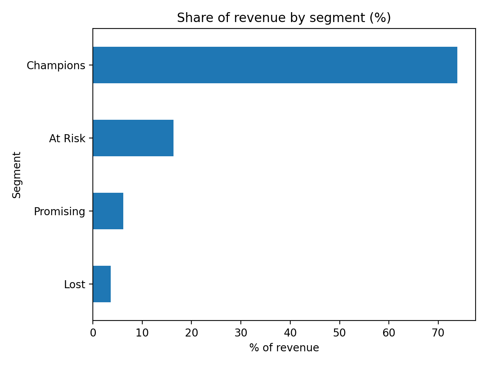
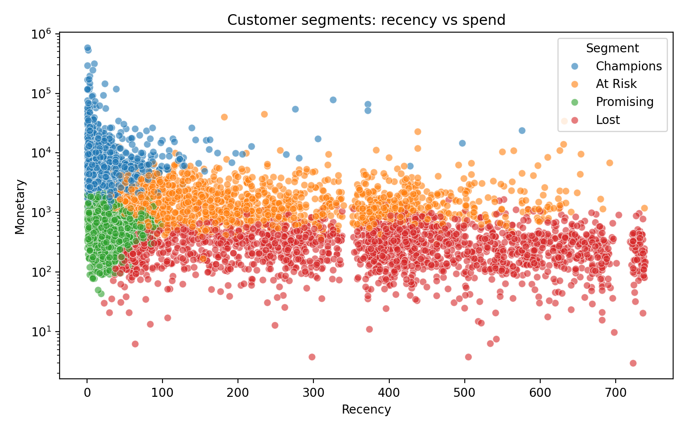

# Customer Segmentation with RFM Analysis and K-Means

Groups 5,878 online-store customers into four segments based on how recently, how often and how much they buy, so a business can target each group with the right action.

## Key finding
**About 20% of customers (Champions) generate about 74% of revenue.**

| Segment | Customers | Avg recency | Avg orders | Avg spend | % customers | % revenue |
|---|---|---|---|---|---|---|
| Champions | 1,196 | 28 days | 19.3 | £10,731 | 20.3% | **73.9%** |
| At Risk | 1,459 | 230 days | 5.1 | £1,949 | 24.8% | 16.4% |
| Promising | 1,250 | 28 days | 3.1 | £858 | 21.3% | 6.2% |
| Lost | 1,973 | 395 days | 1.4 | £317 | 33.6% | 3.6% |

## Data
Online Retail II: 1,067,371 transaction lines from a UK online gift retailer (Dec 2009 - Dec 2011). Source: [paste the link of the page you downloaded it from]. The CSV is not included here.

After cleaning (removing rows with no Customer ID, cancellations, zero/negative quantities or prices, and duplicates), 779,425 rows and 5,878 customers remained.

## Method
1. Cleaned the data and built an RFM table (Recency, Frequency, Monetary value)
2. Log-transformed and scaled the skewed variables
3. Chose K = 4 using the elbow method and silhouette score
4. Profiled each cluster, named the segments and recommended actions

## Recommended actions
- **Champions:** protect with early access and loyalty perks; watch for falling order frequency
- **At Risk:** time-limited win-back offers; the best group to re-activate
- **Promising:** cross-sell and second-purchase incentives
- **Lost:** low-cost reactivation emails only

## Limitations
- Silhouette score is about 0.37, so segments overlap
- 23% of rows had no Customer ID and were excluded
- Data is from 2009-2011 for one retailer, and some high spenders are likely business buyers
- Segments were not tested for predicting future purchases

## How to run
1. Download the dataset from the source above.
2. Open `customer_segmentation.ipynb` in Google Colab.
3. Upload the CSV and run all cells.

## Author
Davee De Silva - [LinkedIn](https://linkedin.com/in/davee-de-silva-756752296)
